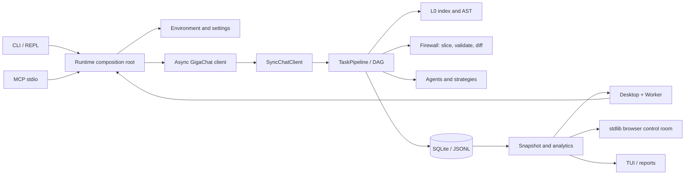

# Архитектурный обзор GigaForge

**Дата:** 2026-10-18  
**Снимок до ядрового этапа:** 150 Python-файлов, 43 307 строк исходного кода.  
**Метод:** статическое чтение дерева, конфигурации, точек входа и ключевых путей выполнения; тесты не запускались.

## Краткий вывод

У GigaForge уже есть сильное ядро agentic harness: единый composition root,
пошаговый DAG, ограничение контекста и diff, маршрутизация моделей, локальная
телеметрия, CLI, desktop, MCP и несколько provider-адаптеров. Главная проблема
проекта сейчас — не отсутствие функций, а разрастание параллельных контрактов:
несколько конфигурационных схем, изменяемое состояние между DAG-узлами и UI-код,
который знает внутренности runtime. Очистка Nexus и исправление загрузки настроек
снимают часть таких расхождений; следующая большая модернизация должна сделать
исполнение изолированным, отменяемым и типизированным.

## Карта системы

`gigaforge/runtime.py` в целом выполняет роль composition root. Асинхронные
транспорт и API сведены к синхронному контракту для DAG через
`core/sync_adapter.py`; интерфейсы читают общие SQLite/JSONL sinks. Это хорошая
основа для единой модели исполнения и воспроизводимой телеметрии.

## Что изменено в этой итерации

- Удалён отдельный Flask/Nexus runtime и его самостоятельные launchers. Desktop,
  CLI и браузерная панель теперь используют основной `ui.chat` и один stdlib
  control-room сервер.
- Внешний bind браузерной панели оставлен read-only. Изменяющий `/api/chat`
  доступен только через loopback; для браузерных запросов проверяются Origin,
  JSON content type и размер тела.
- `.env` и связанные локальные env-файлы исключены из Git. Общая функция записи
  env-настроек выполняет атомарное обновление, сохраняет посторонние строки,
  убирает дубли изменяемых ключей и не скрывает ошибки записи.
- Credential dialog теперь восстанавливает выбранное состояние TLS и явно
  сообщает, если credential применён только для текущего запуска, но не записан.
  TLS verification off принят как настройка совместимости API, а не как ошибка;
  это значение одинаково применяется в `Settings`, низкоуровневом `ClientConfig`,
  legacy env alias и переключателе, который сохраняет выбор.
- Версия packaging приведена к версии пакета, Python-грамматика Tree-sitter
  перенесена в обязательные зависимости. Удалены тестовые e2e-сценарии и пункт
  меню, запускавший отсутствующий test suite. Удалены также осиротевшая root
  страница Cyber Tetris и неиспользуемый `env.example.cyber`.
- `doctor.collect_checks()` стал публичным общим контрактом для CLI и desktop;
  desktop больше не собирает диагностику из приватных `_check_*` функций.
- Git-запросы L0-индекса получили timeout из `L0Config`; зависший `git` теперь
  возвращает управление к детерминированному mtime/hash fallback.
- Управление worktree sub-agent стало безопаснее: нормализованные имена получают
  стабильный суффикс при коллизиях, создание отказывается перезаписывать
  существующий каталог, удаление ограничено зарегистрированным путём под
  worktree root.

Возможность harness запускать проверки целевого репозитория сохранена как
runtime-функция для проверки агентских изменений. Удалены именно локальные
e2e/test-артефакты проекта и их пункт запуска.

## Основные архитектурные риски

### P1 — таймаут DAG не отменяет работу узла

`core/dag.py` ждёт `Future` с таймаутом и вызывает `future.cancel()`, но Python не
может прервать уже исполняющийся worker thread. DAG может записать timeout,
повторить узел и продолжить граф, пока первый вызов всё ещё выполняет побочные
эффекты. Это нарушает смысл жёсткого node timeout и может дублировать запись,
вызов API или изменения рабочего дерева.

**Направление:** ввести per-node cancellation token и протокол кооперативной
отмены для транспорта, sandbox и длительных операций; явно помечать узел как
`timed_out_running`, пока worker действительно не завершился. Для операций с
побочными эффектами добавить idempotency key.

### P1 — параллельные узлы разделяют изменяемый `extras`

`RunContext.child()` передаёт `base.extras` по ссылке. Это удобно для текущего
последовательного handoff, но siblings одного wave при `parallel=True` получают
общий словарь. Контракт не разделяет безопасно чтение и запись, поэтому порядок
завершения может влиять на результат.

**Направление:** сделать вход узла неизменяемым snapshot, а выход — явной
типизированной записью артефактов. Состояние между узлами публиковать только
после завершения wave в стабильном порядке; убрать скрытый канал обмена через
`extras`.

### P1 — конфигурация распределена между несколькими моделями

Настройки представлены в `gigaforge/config.py`, `client/config.py` и
`core/config.py`; `gigaforge/env.py` переводит legacy `GF_*` имена в современные
`GIGAFORGE_*`. Это помогает совместимости, но допускает значения по умолчанию и
имена, расходящиеся между CLI, desktop и низкоуровневым клиентом. TLS-семантика
была одним из таких расхождений; в этой итерации она согласована, остальная схема
ещё требует нормализации.

**Направление:** одна валидируемая `AppConfig` как immutable snapshot на запуск;
legacy env-имена оставить адаптером на входной границе. Runtime должен получать
готовую конфигурацию явно, без неявного чтения окружения глубоко в слоях.

### P2 — desktop-адаптер меняет внутренний граф Runtime

`desktop/context.py` служит полезной границей для UI, но `set_model` и strategy
перенастраивают поля `runtime.pipeline` и `runtime.pipeline.router` напрямую.
Если внутренний граф поменяется, desktop может обновить только часть объектов и
создать рассогласованное состояние.

**Направление:** перенести операции изменения модели, стратегии и provider в
методы Runtime с чётким результатом операции; `AppContext` оставить фасадом для
состояния и UI-данных.

### P2 — доступ к внешней панели остаётся без авторизации для чтения

Изменяющий чат ограничен loopback, но внешний read-only control room отдаёт
snapshot, цели, diff и телеметрию без аутентификации. Это соответствует текущему
сценарию доверенной локальной сети, но не подходит для произвольного публичного
bind.

**Направление:** добавить явно настраиваемую auth-сессию для network bind либо
запретить внешний bind до появления такой модели. Не включать удалённый запуск
задач автоматически вместе с удалённым просмотром.

### P2 — индексатор остаётся единственным обязательным деревом грамматики

Исправленная packaging-конфигурация гарантирует Python grammar для чистой
установки. Остальные языки остаются опциональными. Следующий шаг — единый
registry parser capability, чтобы indexer, slicer и AST edits одинаково
объявляли поддержку и причины пропуска файла.

## Приоритет модернизации

1. **Execution contract:** отмена узлов, изоляция состояния wave, idempotency и
   структурированные причины завершения.
2. **Config contract:** единый immutable конфигурационный snapshot и проверка
   конфликтующих источников env/файла.
3. **Runtime API:** UI и MCP обращаются к публичным методам runtime, а не к
   вложенным объектам графа.
4. **Tool policy:** единые capability-gated инструменты для agents, plugins и
   MCP; одинаковые filesystem/network policy и аудит действий.
5. **Persistence contract:** версии схем SQLite, явные миграции и проверяемая
   совместимость trace/snapshot между запусками и версиями.
6. **Оценка качества:** сохранять offline benchmark как основной продуктовый
   сигнал; расширять его воспроизводимыми сценариями работы всего harness.

## Статические проверки cleanup-этапа

Проверки Ruff для синтаксиса/undefined names (`E9`, `F821`) прошли по пакету
`gigaforge/` и launcher `cyber_ui.py` после исправления семи пропущенных имён в
core, firewall и L0.
Для затронутых модулей также прошли проверки import order, unused imports и
нескольких ошибочных boolean patterns. Более широкий Ruff rule set всё ещё
показывает 181 замечание в этих модулях; основная часть — устаревший стиль
аннотаций (`Optional`, `List`, старые импорты typing). Массовая перепись этих
аннотаций в рамках cleanup не выполнялась.

## Модернизация ядра: первый этап

После обзора заложены базовые контракты масштабирования:

* `CancellationToken` передаётся через `RunContext`; у каждого узла свой токен,
  дочерний от токена запуска. Runtime и pipeline теперь дают публичный способ
  запросить отмену активного run.
* DAG повторно использует ограниченный пул узлов в пределах одного запуска;
  число параллельных wave-узлов ограничено тем же пределом concurrency.
* Повторы выполняются только при явном `idempotent=True`; модельные этапы больше
  не получают скрытый дополнительный вызов с повторной оплатой после ошибки.
* Таймаут узла сигнализирует его токен, а DAG не повторяет timed-out работу и
  не запускает следующий retry, пока первый worker может продолжать выполнение.
  Это кооперативная отмена: Python-поток, застрявший внутри неотменяемого вызова,
  нельзя принудительно завершить; сетевые и внешние операции должны задавать
  собственные конечные таймауты и проверять cancellation на границах.
* Параллельный запуск узлов стал opt-in через `NodeSpec.parallel_safe`. Каждая
  такая задача получает отдельную копию `extras`, а новые значения сводятся в
  детерминированном порядке. Общие входные значения и вложенные объекты нельзя
  изменять из parallel-safe узла.
* Граф проверяет уникальность владельца каждого artifact, а выходной mapping
  обязан совпадать с `NodeSpec.provides`. Это переводит DAG-контракт из подсказки
  в проверяемую границу.
* Изменения config, model client и стратегий проходят через `TaskPipeline` и
  откладываются до завершения активных запусков. Desktop больше не перенастраивает
  внутренние поля router/pipeline напрямую.
* Владение ресурсами стало явным: Pipeline закрывает только созданные им cache,
  checkpoints и metrics; Runtime закрывает переданные ему общие ресурсы после
  завершения запущенных задач.

Этап не делает работу внутри Python-потока принудительно прерываемой и не
переводит файловые операции в отдельный процесс. Для жёсткой изоляции tool
execution потребуется отдельный процессный executor с IPC и проверяемым
протоколом commit/rollback. Текущие изменения не запускались под тестами.

